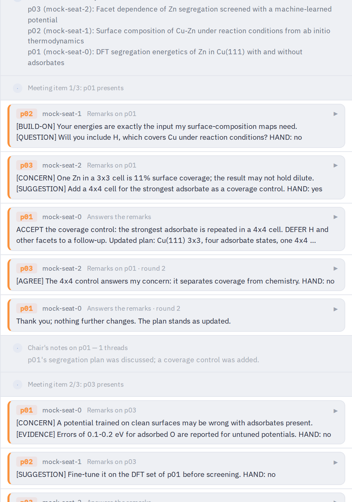

# AURORA

**Long-horizon, open-ended research with AI agents — with auditors that check
the work and a human who stays in charge.**

You give AURORA a research question. Several models propose directions and a
chair picks one; the direction is screened against prior work, planned, checked
with small trial runs and carried out by a research agent in its own container;
the results are analysed, with follow-up rounds when more work is needed, and
written up as a report in which every number links to the script that computed
it. A milestone auditor reviews every hand-off, a live auditor watches the
research agent as it works, and the run asks you whenever a decision should be
yours — while you can talk to it at any time without stopping it.

AURORA is the system of the paper *AURORA: Towards Long-Horizon Open-Ended
AutoResearch with Human-Agent Synergy*.


## Contents

- [What it does](#what-it-does)
- [Quick start](#quick-start)
- [Your first real run](#your-first-real-run)
- [Documentation](#documentation)
- [For AI agents working with this repository](#for-ai-agents-working-with-this-repository)
- [Repository](#repository) · [Reproducing the paper](#reproducing-the-paper) · [Citation](#citation) · [License](#license)

## What it does

### The research cycle

| Phase | What happens |
|---|---|
| **Ideation** | Heterogeneous models each propose a direction, either independently or at a group meeting where they question each other's ideas; a chair decides and says why the others were set aside. |
| **Screening** | The chosen direction is scored for novelty, feasibility and significance, and compared with the closest prior work found in the literature. |
| **Planning** | The direction becomes a dependency graph of jobs, each with what it must produce. |
| **Pre-flight** | Small trial runs and checks of inputs, software and parameters before anything expensive starts. |
| **Research** | A research agent (a Claude Code session, driving any model through OpenRouter) carries out each job in the run's Docker container; several jobs can run at once. |
| **Analysis** | Checks the results against the objective; can send the run back for another round. |
| **Writing** | A report with figures, verified references and a result ID after every number. |

Any phase can be skipped. Checkpoints after every step let a stopped or failed
run continue where it was. See [How a campaign runs](docs/concepts/pipeline.md).

### Oversight: auditors and you

- **Milestone auditor** — reviews the output of every phase before the next one
  builds on it: *pass*, *reject* (with what to fix) or *escalate* to you.
- **Live auditor** — reads the research agent's work as it happens and can let
  it *continue*, *advise* it, *interrupt* the current step or *escalate*.
- **Human gates** — the run stops for you only where it matters (an
  escalation, a direction to confirm, pre-flight problems). In *autonomous*
  mode it records the decision and goes on.
- **Duplex interaction** — a front desk agent answers questions about a running
  experiment and passes your instructions to the agent mid-turn, without
  stopping it.
- **Notifications** — WeCom, Feishu, Slack, WeChat (Server酱) or any webhook,
  with *Approve* and *Stop* links that answer a decision from your phone, and
  quiet hours.
- **Budgets and estimates** — a cost and time estimate before a run starts
  (from your earlier runs, or typical phase costs at the chosen models'
  prices), hard limits on cost and time, and a warning when a run goes past its
  estimate.

See [The auditors](docs/concepts/auditors.md) and
[Working with the human](docs/concepts/human-in-the-loop.md).

### Results you can trace

- **Every number is recorded** when an agent computes it (`aurora results
  record`), with a copy of the script as it was then, the command, the files it
  read and wrote, and the job. The report cites results as `{R3}`; the console
  turns each into a chip that shows all of this.
- **Downloads** — the report as Markdown and LaTeX with figures, bibliography
  and a results table; the whole run directory; and `reproduce.sh`, which
  replays the commands that produced the results in the run's image.
- **Overleaf** — put a report into a folder of your Overleaf project in one click.
- **Compare runs** side by side: setup, cost, time, results matched by name and
  conclusions, with the differences marked.
- **Fork a run** from after any phase or research job, with new guidance,
  another direction (an idea the meeting did not choose, or your own), another
  model or another budget.

See [Results, reports and runs](docs/guide/results.md).

### Ideas and literature



- **Real papers, checked references** — agents search OpenAlex, Crossref,
  arXiv and Semantic Scholar (`aurora papers`), and every reference they cite is
  checked against those indexes; one that cannot be found is flagged, never
  presented as real.
- **Library** — the papers of all your projects, with your notes; two-way sync
  with a Zotero collection, including PDFs and highlights.
- **Brainstorm** — think out loud with a *Skeptic*, *Methods* and a
  *Librarian* agent, keep ideas as arguments (evidence for and against, open
  questions, next steps), and turn one into an experiment proposal.
- **Feed** — new papers and posts from the people and sources you follow,
  ranked against your projects, with one sentence on why each fits.

See [Literature](docs/concepts/literature.md), [Brainstorm](docs/concepts/brainstorm.md),
[Zotero](docs/guide/zotero.md) and [The feed](docs/guide/feed.md).

### Compute

- **One Docker container per run**, with CPU and memory limits you can change
  while it runs; the agents cannot touch anything else on the machine.
- **GPU jobs** — agents send training and long runs to a **SLURM cluster** or
  to a **GPU machine over SSH** (the workspace is copied there and back, free
  GPUs are found with `nvidia-smi`, and a job waits while none are free). While
  a job runs, the agent can pause: no model calls and no cost until the job
  ends. The console shows every job and what its GPUs are doing.
- **Skills** — procedures you write, and ones distilled from earlier runs and
  from your corrections, available to every agent.

See [Sandbox and security](docs/guide/sandbox.md),
[GPU jobs](docs/guide/cluster-jobs.md) and [Skills](docs/concepts/skills.md).

### Teams

Out of the box the console is for one person. Turn on accounts and each person
signs in, uses their own API key, and keeps projects private until they share
them, with fine-grained rights (view, comment, edit, run, decide, share,
manage). A confidential project is hidden from the rest of the team, cannot be
shared by link, keeps its learned skills to itself and uses only model
providers that keep no data. See [Accounts and sharing](docs/guide/accounts.md).

## Quick start

AURORA needs Python 3.11 or newer.

```bash
git clone https://github.com/prentisai/aurora && cd aurora
pip install -e .
aurora demo                     # the whole pipeline offline, in seconds
```

`aurora demo` replays a small scripted materials study with mock models: no
API key, no Docker, no cost. It shows what a run produces and where.

For the web console, build it once (Node.js 18+) and start it:

```bash
(cd frontend && npm ci && npm run build)
aurora serve                    # http://localhost:8000
```

The start page lists what a real run still needs, lets you paste your
OpenRouter key, and has **Watch a demo run** for the same scripted study in the
browser.

## Your first real run

Real runs need [Claude Code](https://docs.claude.com/en/docs/claude-code)
(the agents run in it), Docker and an [OpenRouter](https://openrouter.ai) key
(one key for every model: Claude, GPT, Gemini, Kimi, DeepSeek, ...):

```bash
npm install -g @anthropic-ai/claude-code
mkdir -p ~/.aurora && echo "OPENROUTER_API_KEY=sk-or-..." > ~/.aurora/.env
aurora doctor                   # checks all of it
```

**From the browser:** type what you want to find out on the start page, or
pick a template (analyse a dataset, compare methods, reproduce a paper, explore
an open question, run a simulation study). The front desk asks what is unclear
and shows a proposal card with the phases, models, budget and an estimate of
cost and time; confirm it and the run starts.

**From the command line:**

```bash
aurora run examples/quickstart/aurora.yaml      # a few minutes, a few dollars
aurora init                                     # a commented config for your own question
```

```yaml
objective: >
  When does gradient boosting beat a random forest on small tabular data,
  and when is the difference just noise?
inputs: [./data]
budget: {max_cost_usd: 30}
```

`aurora status <run>` shows where a run is and `aurora resume <run>` continues
one that stopped. See [Your first campaign](docs/getting-started/first-campaign.md).

### Commands

| Command | |
|---|---|
| `aurora run <config>` | run a campaign from a config file |
| `aurora serve` | the web console |
| `aurora demo` | the offline demo |
| `aurora init` | write a commented starter config |
| `aurora doctor` | check Claude Code, Docker, the key and the config |
| `aurora status` / `aurora resume` | where a campaign is / continue it |
| `aurora skills` | the skill library shared by all campaigns |
| `aurora users` | accounts of the web console |
| `aurora job`, `aurora papers`, `aurora results` | used by a running experiment's agents (GPU jobs, literature, results) |

## Documentation

The documentation is in [`docs/`](docs/) and reads directly on GitHub:

| | |
|---|---|
| Getting started | [Installation](docs/getting-started/installation.md) · [Your first campaign](docs/getting-started/first-campaign.md) |
| Concepts | [How a campaign runs](docs/concepts/pipeline.md) · [Ideation](docs/concepts/ideation.md) · [Auditors](docs/concepts/auditors.md) · [Working with the human](docs/concepts/human-in-the-loop.md) · [Literature](docs/concepts/literature.md) · [Brainstorm](docs/concepts/brainstorm.md) · [Skills](docs/concepts/skills.md) |
| Guides | [Command line](docs/guide/cli.md) · [Web console](docs/guide/web-console.md) · [Results, reports and runs](docs/guide/results.md) · [Accounts and sharing](docs/guide/accounts.md) · [The feed](docs/guide/feed.md) · [Zotero](docs/guide/zotero.md) · [Notifications](docs/guide/notifications.md) · [GPU jobs](docs/guide/cluster-jobs.md) · [Models and costs](docs/guide/models-and-costs.md) · [Sandbox and security](docs/guide/sandbox.md) · [Troubleshooting](docs/guide/troubleshooting.md) |
| Reference | [Configuration](docs/reference/configuration.md) · [Campaign files](docs/reference/workspace.md) · [Events](docs/reference/events.md) |

## For AI agents working with this repository

If you are an agent asked to use or change AURORA:

- **To run it**, use the CLI: `aurora --help`, `aurora doctor`, `aurora demo`
  (offline), `aurora run <config>`. Every configuration key, with its default
  and meaning, is in [the configuration reference](docs/reference/configuration.md)
  (generated from `aurora/config.py`); `aurora init` writes a commented example.
- **To read a run**, look in its directory (layout in
  [Campaign files](docs/reference/workspace.md)): `checkpoint.json` (where it
  is), `results.jsonl` (every recorded result and its provenance),
  `phases/writing/draft_N.md` (the report), `audit_records/` (the milestone
  auditor's verdicts) and `trajectory.jsonl` (all events, described in
  [Events](docs/reference/events.md)).
- **To change it**, start from the files below. The test suite runs offline
  with mock models: `pip install -e ".[dev]" && pytest`. The frontend is
  checked with `cd frontend && npx tsc -b && npx oxlint src`.

| Where | What |
|---|---|
| `aurora/core/engine.py` | the campaign: phases, checkpoints, budgets, the services agents use |
| `aurora/agents/`, `aurora/screening/`, `aurora/planning/` | ideation seats and chair, screening, planning, analysis, writing |
| `aurora/core/supervisor.py`, `aurora/hooks/audit_hooks.py` | the live auditor and the milestone audits |
| `aurora/core/terminal_iteration.py` | one research job (a Claude Code session, retries, waiting for GPU jobs) |
| `aurora/human/` | the front desk and decision links |
| `aurora/results/`, `aurora/literature/`, `aurora/compute/` | `aurora results`, `aurora papers`, `aurora job` (SLURM and SSH) |
| `aurora/api/` | the web console's API (FastAPI); `aurora/auth/guard.py` holds the access rule of every route |
| `frontend/src/` | the web console (React, TypeScript) |
| `aurora/config.py` | every configuration option |

## Repository

| Path | Contents |
|---|---|
| `aurora/` | the Python package (engine, agents, auditors, web API) |
| `frontend/` | the web console (React) |
| `examples/` | quickstart, an open-ended campaign, the materials case study |
| `experiments/` | scripts and released data to reproduce the paper's evaluations |
| `docs/` | documentation (MkDocs) |
| `tests/` | offline test suite (`pytest`) |

## Reproducing the paper

`experiments/` contains the evaluation of the auditors, of auditor
interventions and of multi-agent ideation, with the released data and the
commands that recompute every reported number offline. See
[experiments/README.md](experiments/README.md).

## Citation

```bibtex
@misc{aurora2026,
  title  = {AURORA: Towards Long-Horizon Open-Ended AutoResearch with Human-Agent Synergy},
  author = {Yanlin Fei and Nazhou Liu and Lei Li and Xinmiao Yu and Shaolong Chen and
            Madalina Ciobanu and Navan Preet Singh and Qingqing Mao and Ritankar Das},
  year   = {2026},
  note   = {arXiv preprint}
}
```

## License

MIT — see [LICENSE](LICENSE). The released experiment data is CC-BY-4.0.
