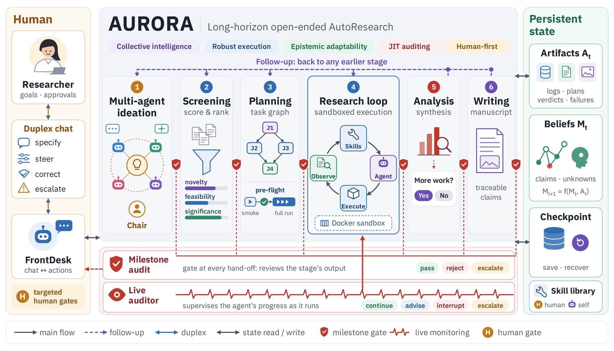

# AURORA

**Long-horizon, open-ended research with AI agents — with auditors that check
the work and a human who stays in charge.**

You give AURORA a research question. Several models propose directions and a
chair picks one; the direction is screened, planned and carried out by a
research agent in a sandbox; the results are analysed, with follow-up rounds
when more work is needed, and written up. A milestone auditor reviews every
hand-off, a live auditor watches the research agent as it works, and the
campaign asks you whenever a decision should be yours — while you can talk to
it at any time without stopping it.



## Highlights

- **Multi-agent ideation** — heterogeneous models propose research directions,
  as a group meeting or independently, and an independent chair decides.
- **Two auditors** — a *milestone auditor* reviews the output of every phase
  (pass / reject / escalate); a *live auditor* reads the research agent's
  transcript as it runs (continue / advise / interrupt / escalate).
- **Human gates and duplex interaction** — the campaign stops for your decision
  only where it matters; a front desk agent answers your questions and relays
  your instructions to the running agent.
- **Sandboxed execution** — one Docker container per campaign; the agents
  (Claude Code sessions) cannot touch anything else on your machine.
- **Cluster jobs** — agents submit training and long runs to SLURM (same image,
  same workspace, on a GPU node) and keep working while they run.
- **Skill library** — skills you write and skills distilled from earlier
  campaigns are available to every agent.
- **Resumable and budgeted** — checkpoints after every step; hard limits on
  time and API cost.
- **CLI and web console** — the same pipeline from `aurora run` or from the
  browser.
- **Notifications** — WeCom, WeChat (Server酱), Feishu, Slack or any webhook
  tell you when a decision waits for you or an experiment ends.

## Quick start

```bash
pip install aurora-research
aurora demo                     # the whole pipeline offline, in seconds
```

For real campaigns you need [Claude Code](https://docs.claude.com/en/docs/claude-code),
Docker and an [OpenRouter](https://openrouter.ai) key:

```bash
npm install -g @anthropic-ai/claude-code
mkdir -p ~/.aurora && echo "OPENROUTER_API_KEY=sk-or-..." > ~/.aurora/.env
aurora doctor                   # checks all of it

git clone https://github.com/titanresearchlabs/aurora && cd aurora
aurora run examples/quickstart/aurora.yaml      # a few minutes, a few dollars
aurora serve                                    # the web console on http://localhost:8000
```

Start your own campaign with `aurora init`, which writes a commented config:

```yaml
objective: >
  When does gradient boosting beat a random forest on small tabular data,
  and when is the difference just noise?
inputs: [./data]
budget: {max_cost_usd: 30}
```

## Documentation

The [documentation](https://titanresearchlabs.github.io/aurora) covers
[installation](docs/getting-started/installation.md),
[a first campaign](docs/getting-started/first-campaign.md),
[how a campaign runs](docs/concepts/pipeline.md),
[the auditors](docs/concepts/auditors.md),
[working with the human](docs/concepts/human-in-the-loop.md),
[the web console](docs/guide/web-console.md),
[models and costs](docs/guide/models-and-costs.md),
[the sandbox](docs/guide/sandbox.md) and the
[configuration reference](docs/reference/configuration.md).

## Repository

| Path | Contents |
|---|---|
| `aurora/` | the Python package (engine, agents, auditors, web API) |
| `frontend/` | the web console (React) |
| `examples/` | quickstart, an open-ended campaign, the materials case study |
| `experiments/` | scripts and released data to reproduce the paper's evaluations |
| `docs/` | documentation (MkDocs) |
| `tests/` | offline test suite (`pytest`) |

## Reproducing the paper

`experiments/` contains the evaluation of the auditors, of supervisor
interventions and of multi-agent ideation, with the released data and
commands that recompute every reported number offline. See
[experiments/README.md](experiments/README.md).

## Citation

```bibtex
@misc{aurora2026,
  title  = {AURORA: Towards Long-Horizon Open-ended AutoResearch with Human-Agent Synergy},
  author = {The AURORA authors},
  year   = {2026},
  note   = {arXiv preprint}
}
```

## License

MIT — see [LICENSE](LICENSE). The released experiment data is CC-BY-4.0.
