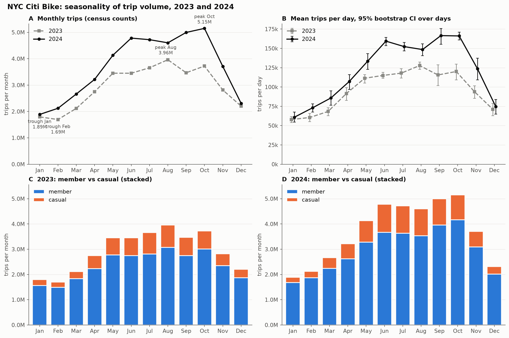
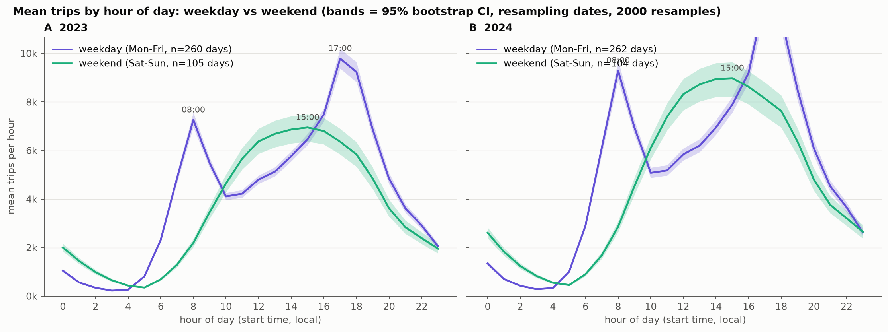
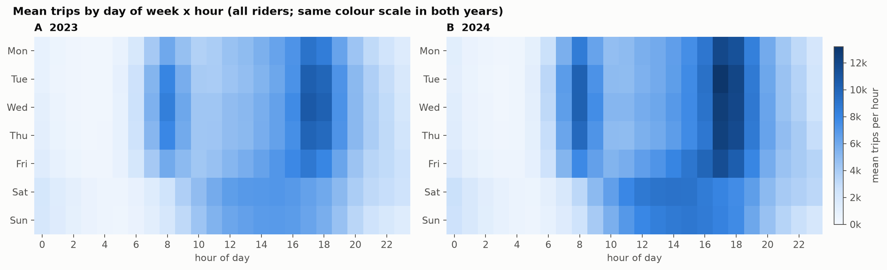
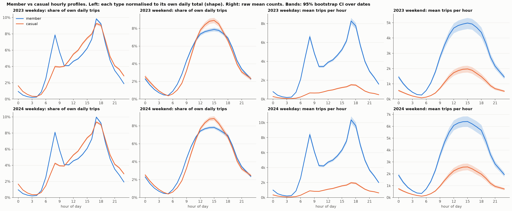
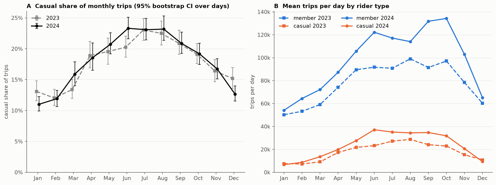
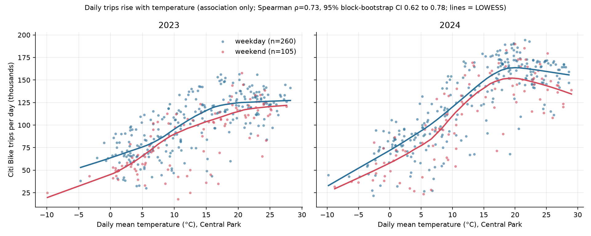
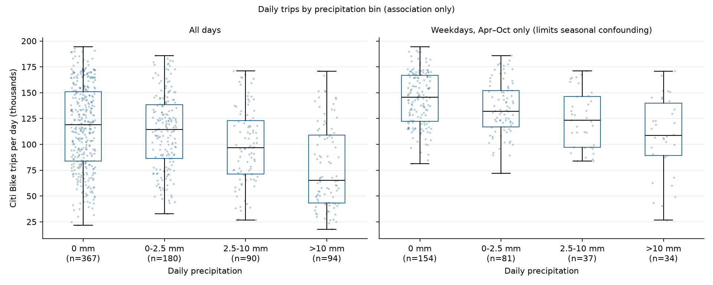

# NYC Citi Bike usage patterns, 2023–2024

## Executive summary

We analysed 79.4M Citi Bike trips (2023 and 2024) and kept 79,371,599 after cleaning (0.049% removed). All findings are descriptive associations from one city and two years. None is a causal claim.

1. **Seasonality.** Volume is lowest in winter (January/February) and highest in a broad summer–autumn plateau. The peak/trough ratio is 2.3 (2023) and 2.7 (2024) on monthly totals. The single peak month is not well pinned down (August 2023, October 2024; bootstrap agreement 55–88%). 2024 exceeds 2023 in every month (about 1.26x overall).
2. **Day and hour.** Weekdays have two commute peaks, at 08:00 and 17:00, in both years (100% of bootstrap resamples agree). The 17:00 peak is about 2.0x the midday level and the 08:00 peak about 1.5x. Weekends have one broad peak centred on 15:00 (a plateau, so the exact hour is less certain). Sunday is the quietest day (about 0.85–0.88 of the weekly mean). The ordering of weekdays is not consistent between years.
3. **Members vs casual riders.** Casual riders take a larger share of trips on weekends (35.4% vs 23.3% for members in 2023; the CIs do not overlap). They show a weak or absent weekday morning peak, much stronger seasonality (peak/trough about 4.4–5.4 vs 2.1–2.5) and longer trips (median about 13–14 vs about 8.4–8.6 min).
4. **Weather (optional question).** Daily trips are positively associated with temperature (Spearman rho 0.73, CI 0.62–0.78) and negatively with rain (rho -0.29, CI -0.38 to -0.19). Rain days are 9%, 23% and 42% lower than dry days in the three rain bins. Season cannot be fully separated from temperature.

## Data and methods

- **Source.** Citi Bike monthly trip-history files from s3.amazonaws.com/tripdata, 2023 and 2024. All 24 months were obtained, with 35,106,986 raw rows for 2023 and 44,303,209 for 2024. CSV and parquet row counts match, and every `ride_id` is unique.
- **Provenance caveat.** The 2023 monthly URLs returned 404, so 2023 came from the yearly zip, which nests 12 monthly zips. Equivalence with the original monthly files was not verified. Row counts and date ranges look plausible.
- **Cleaning** (`/app/code/02_clean_aggregate.py`). Each row is counted against the first rule it fails.

| Rule | Removed |
|---|---|
| R1 missing timestamps | 0 |
| R2 duplicate ride_id | 0 |
| R3 duration ≤ 0 s | 643 |
| R4 duration < 60 s | 182 (825 when applied alone) |
| R5 duration > 24 h | 37,576 |
| R6 start outside 2023–2024 | 195 (276 when applied alone) |
| R7 invalid rider type | 0 |
| **Total removed** | **38,596 of 79,410,195 (0.049%)** |

  - **R3 is a daylight-saving artifact.** All 643 negative durations fall on the two fall-back dates (2023-11-05 and 2024-11-03), where the repeated 01:00 hour makes some trips look negative.
  - **Spring-forward effect.** The 02:00 bin is empty on the two spring-forward dates.
  - **R5 by year.** R5 removed 26,640 trips in 2023 and 10,936 in 2024. I did not investigate why.
  - **Sensitivity.** Keeping or dropping the sub-60 s trips changes 182 rows, so no finding depends on it.
- **Analysis.** Trips are binned by local start time. Uncertainty is shown as 95% bootstrap CIs (2,000 resamples, seed 20240501), resampling days. Peak-hour stability is the fraction of resamples that give the same peak hour. Sensitivity checks exclude 22 federal-holiday weekdays and the 4 daylight-saving dates.
- **Weather.** Open-Meteo archive daily values for Central Park (one grid point, a proxy for the whole city), 731 days with no gaps. Log daily trips are regressed on temperature (quadratic), rain bins, day of week, holiday and year. Newey-West HAC standard errors use 7 lags. A sensitivity model adds month fixed effects.

## Results

### 1. Seasonality

*Figure 1. Monthly trips (A), mean trips per day with bootstrap CI (B), and member/casual stacks (C, D).*

- **Range.** 2023 runs from 1.69M (February) to 3.96M (August). 2024 runs from 1.89M (January) to 5.15M (October).
- **Peak/trough.** The ratio is 2.34 (2023) and 2.73 (2024) on monthly totals. Per day it is 2.2 (CI 2.07–2.42) and 2.7 (CI 2.49–3.14).
- **Peak month is uncertain.** It differs between years and between total and per-day measures (2024 per day peaks in September). Bootstrap agreement on the peak month is 55–88%. Describe a plateau, not one peak month.
- **Winter share.** December–February holds 16% of annual trips in 2023 and 14% in 2024. June–October holds 52% and 55%.
- **Growth.** 2024/2023 is 1.26x overall. The per-day ratio is above 1 in all months (range 1.05–1.44), and smallest in winter (December 1.05, January 1.05). The monthly shape correlates strongly between years (Pearson 0.96).
- **Interpretation.** The electric-bike share rose from 50.2% to 66.1%. This study cannot attribute the growth to e-bikes, fleet expansion or demand.

### 2. Day of week and hour of day

*Figure 2. Mean trips per hour, weekday vs weekend, with bootstrap bands. Known plot defect: in the 2024 panel the y-axis clips the weekday 17:00 peak, and the 08:00 label overlaps the legend. The values are in `peak_hours.csv`.*

*Figure 3. Mean trips by day of week and hour, same colour scale in both years.*

| | 2023 | 2024 |
|---|---|---|
| Weekday AM peak hour (resample agreement) | 08:00 (100%) | 08:00 (100%) |
| Weekday PM peak hour (resample agreement) | 17:00 (100%) | 17:00 (100%) |
| AM peak / midday (11–14h) mean | 1.46 (1.40–1.51) | 1.54 (1.48–1.59) |
| PM peak / midday mean | 1.97 (1.91–2.02) | 2.04 (1.99–2.09) |
| Weekend peak hour (resample agreement) | 15:00 (96%) | 15:00 (73%) |

- **Holidays.** Excluding federal holidays shifts the ratios by 0.03–0.04 and leaves the peak hours unchanged.
- **Winter 2024 weekends.** The Jan–Feb weekend peak falls at 14:00, with only 48% agreement. The weekend peak is a plateau.
- **Daylight saving.** All four daylight-saving dates fall on Sundays, so that sensitivity affects only the weekend profile.
- **Weekend share.** Weekends hold 25.5% of trips (2023) and 26.1% (2024), against 28.8% and 28.4% of days.
- **Sunday is the lowest day** at 0.848 (2023) and 0.879 (2024) of the weekly mean. The busiest weekday differs: Wednesday in 2023 and Friday in 2024. Weekday differences are mostly within the CIs.

### 3. Member vs casual riders

*Figure 4. Hourly profiles by rider type. The left panels are normalised to each type's own daily total. The right panels show raw counts.*

*Figure 5. Casual share of trips by month (A) and trips per day by rider type (B).*

| | Member | Casual |
|---|---|---|
| Share of trips (2023 / 2024) | 81.2% / 80.7% | 18.8% / 19.3% |
| Weekend share of trips, 2023 (95% CI) | 23.3% (22.1–24.4) | 35.3% (33.2–37.3) |
| Weekend share of trips, 2024 (95% CI) | 23.8% (23.0–24.6) | 35.6% (33.8–37.3) |
| Weekday AM peak 2023 / 2024 | 08:00 / 08:00 (about 1.6–1.7x midday) | none distinct in 2023 (resample agreement 65%); weak in 2024 (about 0.76x midday) |
| Weekday PM peak | 17:00 | 17:00 (smaller) |
| Peak/trough per day 2023 / 2024 | 2.0 / 2.5 | 3.9 / 5.5 |
| Median trip duration (min) | 8.6 (2023), 8.3 (2024) | 13.8 (2023), 13.1 (2024) |

- **Weekday profile.** Weekday profile distance is moderate (Jensen-Shannon about 0.12). Weekend profiles are nearly identical (about 0.06).
- **Casual share.** It runs from about 11–13% in winter to 23% in summer.
- **Not a clean split.** Casual weekday evening use still follows a commute-like peak. This is consistent with leisure and tourist use but does not show it.

### 4. Weather association (optional question)

*Figure 6. Daily trips vs mean temperature (LOWESS lines).*

*Figure 7. Daily trips by precipitation bin (all days; weekdays Apr–Oct to limit seasonal confounding). Bins hold 367, 180, 90 and 94 days.*

- **Temperature.** Spearman rho is 0.73 (block-bootstrap CI 0.62–0.78). It is 0.81 for casual riders and 0.66 for members, and similar on weekdays (0.74) and weekends (0.73).
- **Rain.** Spearman rho is -0.29 (CI -0.38 to -0.19). Adjusted for temperature and calendar, trips relative to dry days are:
  - 0–2.5 mm: -9% (CI -11 to -6)
  - 2.5–10 mm: -23% (CI -27 to -19)
  - >10 mm: -42% (CI -48 to -36)
- **Nonlinearity.** About +38% per +10 °C from 10 to 20 °C, but only about +11% per +10 °C from 20 to 30 °C (CI 3–19%). The curve flattens near 29 °C.
- **Season vs weather.** R² of log trips is 0.50 for temperature alone and 0.11 for calendar alone. It is 0.62 for month plus calendar and 0.80 for the full model. With month fixed effects the temperature coefficient stays at about +3.7% per °C (CI 3.0–4.4%). Day-to-day variation within a month is therefore associated with trips, but daylight, school calendar and tourism cannot be separated from temperature.
- **Rain by season.** Days over 2.5 mm are 17% (autumn) to 32% (summer) of days, so wet days are not concentrated in cold months.

## Hypotheses and outcomes

| Hypothesis | Outcome |
|---|---|
| Volume is strongly seasonal, with the same shape in both years | Confirmed (confidence 0.93) |
| Weekday use is commute-shaped and weekend use is leisure-shaped | Confirmed (0.90) |
| Members behave like commuters and casual riders like leisure riders | Confirmed with caveats (0.85). Casual evening use still has a commute-like peak |
| Daily volume rises with temperature and falls with rain beyond seasonal structure | Supported association (0.78). Not causal |
| Results are an artifact of data quality or cleaning | Refuted (0.05). 0.049% removed, and an independent re-query reproduced the 24 monthly counts, the clean total and the peak hours |

## Limitations and open questions

- **Scope.** One city, two years. 2024 growth is system-wide and its cause (e-bikes, fleet, demand) is not identifiable here.
- **Peak month and weekday order.** Not stable across years or measures. Peak month agreement is only 55–88%.
- **2023 provenance.** The yearly zip was not verified against the original monthly files.
- **R5.** The 2023 vs 2024 difference in >24 h trips (26,640 vs 10,936) was not investigated. It is below 0.08% of trips.
- **Rider type.** The `member_casual` definition may have changed over time. This cannot be checked within these two years.
- **Weather.** One Central Park point stands in for the whole city, and daily totals hide timing. Residuals are autocorrelated (Durbin-Watson 1.15), so CIs may be somewhat narrow. The year indicator absorbs the 2024 level shift (about 96k to 121k trips per day) only as a constant.
- **Daylight saving.** Hours 01:00 and 02:00 are distorted on four dates.
- **Figures.** The monthly figure has overlapping trough labels, and the 2024 weekday-hourly axis clips the 17:00 peak. The palette was not validated. I checked six figures visually and did not check `fig_hourly_seasonal_robustness.png`, which is copied here but not used.

## Reproducibility

Code is in `/app/code` (`01_acquire.py`, `02_clean_aggregate.py`, `03_temporal_analysis.py`, `04_weather.py`) in the campaign container. Tables are in `/app/output/tables` and figures in `/app/output/figures`. Weather source details are in `weather_source.json`.
