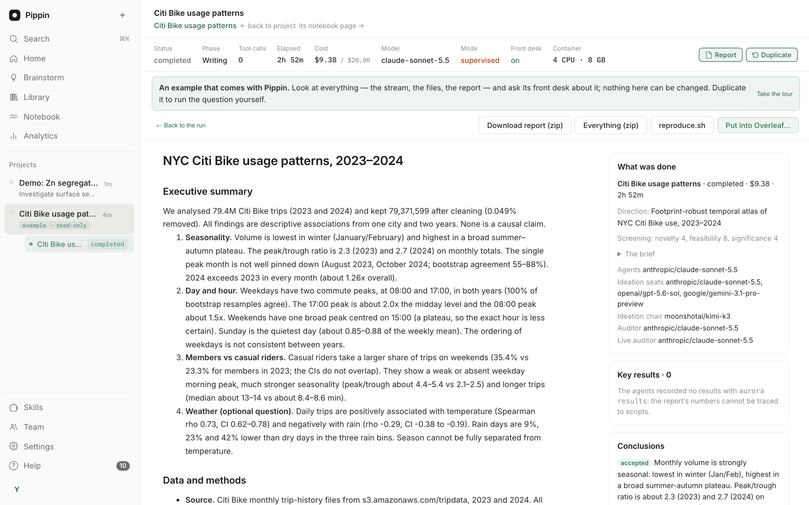

# Web console

```bash
aurora serve              # then open http://localhost:8000
```



## Finding your way

The left bar lists your projects and their runs, and the places of the console, one open at a time: **Home**,
**Brainstorm**, **Library**, **Notebook** and **Analytics**, then **Skills**, **Team** (with accounts) and
**Settings**. **Search** (⌘K) opens over whatever page is open, and **Help** is a drawer beside it, so neither
replaces the page you are on.

**⌘K, anywhere.** A box that knows what you are looking at: the project, the run, the text you selected. Type and
press Enter to ask Pippin about it (the same conversation as the orb's and the browser's side panel; what is in
front is passed along, not kept as your words), or pick a page, a project or a run, or a report, conversation or
skill that the search finds. ↑ ↓ choose, Esc closes. An answer opens in the box, with buttons to the pages it names.

## The first time

**The start page is a conversation.** *Hi, I'm Pippin. What would you like to do?* — start your own experiment,
work out the question first (with the Mentor), or see how it works (a finished run with the tour, or a scripted run
to watch). It then sets this machine up for what you chose, one thing at a time and only what that needs: the model
key (pasted there, checked with OpenRouter and saved in `AURORA_HOME/.env`, readable only by the console's user),
Claude Code (installed for you in the background) and Docker (the one thing you install yourself, since its
installer asks for your password; the page notices when it runs, or takes the path of its `docker` command). Once a
key is there, what you type is read by a model, so *no idea yet* brings the Mentor and examples rather than being
taken for a research question. It says what the next page is for and takes you there. The conversation is kept in
this browser; a question you typed survives the setup.

**Today.** Once you have a project of your own, Home opens on Today (the start conversation is one click away,
**New question**): one sentence on how things stand; what waits for you from every project, answered right there
(a run's decision — continue, reply with an instruction, stop, or open the run to choose a direction —, what the
notebook flagged such as a retraction or a paper close to your aim, a skill to approve); what changed since
yesterday; the papers most worth reading; and a box to ask Pippin.

**Examples.** A console comes with finished runs to look at: *Citi Bike usage patterns*, a real run from question
to report (with a screening decision and the live auditor stopping the agent), and the scripted demo. An example is
marked *example · read-only* in the project list: everyone can open its stream, files and report and ask its front
desk about it, nobody can change or delete it. **Duplicate it as my project** makes a project of your own with its
question, ready to run. Help → Examples lists them; each person can hide them from their project list, and an admin
can take one out of the console (and put it back).

**Watch a run** adds a run of scripted models and simulated tools to your demo project (made the first time): the
ideation meeting, every phase, the auditors' checks and a report, in seconds, with no key, no Docker and no cost.

**The tour.** Three chapters, each a spotlight on one part of the console with what it is and what to do there:
*A finished run* (the project list, where a run is, report, re-run and fork, the stream and its decisions, files
and jobs, talking to a run, the report and where each number comes from), *Around Pippin* (every place in the left
bar, ⌘K included) and *Your own research* (the brief, the proposal, a run at work, what comes after). Arrow keys
move through it; Esc ends it.

**Help (?).** At the bottom of the left bar, with the number of things not tried yet:

- *Ask how to do something*: answered from the documentation by the front desk's model, with links to the pages
  (without a key, the matching pages);
- *Getting started*: a checklist that ticks itself as you do things — connect a key, walk through the example,
  watch the demo, start your own research, answer a decision, trace a number in a report, brainstorm, bring in
  papers, get decisions on your phone, find your way around (and, for admins, connect GPUs and invite the team);
- the tours, the examples, and every guide of the documentation, read in the console.

**First-time tips.** The first time something appears — a proposal card, a decision, a run at work, a report,
Compare, Fork, GPU jobs, the Brainstorm, the Library — a short tip says what it is; *Got it* hides it for good, and
Help can show them all again.

## Projects and experiments

A **project** groups related experiments. Type what you want to investigate on the start page (or **+** in the
left bar) to create one. The project's front desk asks what is unclear and then shows a **proposal card**: the
instruction the agents will get, a summary, and the phases to run. Change the phases on the card, choose the
ideation mode (*Round table* or *Independent*) when ideation runs, set the budget (US$20 by default; empty means no
limit), or ask the front desk to change the instruction, then **confirm** to start the experiment. *Advanced
settings* on the card set whether decisions wait for you (supervised or autonomous), the model of every role (the
agents of each phase, the ideation seats and chair, both auditors and the front desk), and the container's CPUs
and memory. The card also shows what the run will likely cost and take
([Estimate](results.md#estimate-before-a-run)).

A project opens like a document, its **Overview**: its question, where it stands (a sentence or two from what its
runs are doing), what waits for you (answered there), what its runs found (the claims each run kept, with how they
stand) and its runs. Its other views are tabs: **Chat** (the project's front desk), **Literature**, and **Compare**
once it has several runs.

An **experiment** (a run) is one campaign. Its page has no tabs: the left bar goes to the project's other runs and
the header back to the project. It shows

- the **phase pipeline** and the current phase;
- the **live stream**: the ideation meeting as it happens (each seat's presentation and remarks appear while they
  are written), agent reasoning and tool calls, job boundaries, milestone audit verdicts, live-auditor verdicts,
  human gates, front-desk messages and skill suggestions;
- the **files** of the experiment: its campaign directory (plans, audit reports, transcripts, the report) and,
  while it runs, the container's `/app` (`app (live container)`). You can open and edit files; edits to container
  files go straight into the running container;
- the **cost** so far;
- the container's **CPU and memory limits** (*Container*): click to change them, at once while the experiment
  runs, or for its resume or re-run;
- **Report**, once there is one: every number traced to the script that computed it, downloads, a script that
  reproduces it, and *Put into Overleaf*; **Fork...** starts a new run from any phase or job of this one. See
  [Results, reports and runs](results.md);
- a link to the run's page in the [Notebook](../concepts/memory.md#a-page-for-every-run): its idea, hypothesis,
  expected against actual, and your notes on it.

## Talking to an experiment

Type in the experiment chat. While the experiment runs, its front desk answers
questions and relays instructions to the research agent; afterwards it answers
questions about the experiment from its files. *Front desk* in the header
switches it off (no model calls; while the experiment runs, messages then go
straight to the agent). The project chat can look into all runs of the project
and propose experiments that build on them (see
[Working with the human](../concepts/human-in-the-loop.md#front-desks-in-the-web-console)).

## Decisions

When the experiment needs a decision, an approval bar appears with the
reason. Choose **Continue**, write an instruction and **Send instruction**, or
**Stop**. A message with **Continue** is passed on as a note. When screening keeps
rejecting the proposals, you can also write which direction to pursue (one of
the proposals, with changes, or your own idea) and choose **Choose the
direction**: the stream shows how your message was understood. Tick *ideation*
and/or *screening* next to the button to run your direction through them first;
otherwise planning starts from it at once. The *Supervised / Autonomous* switch changes whether such gates wait
for you.

## Stop, resume, re-run

- **Stop** ends the experiment at the next safe point; its files stay.
- **Resume** continues a stopped or failed experiment from its checkpoint.
- **Re-run** starts a new experiment with the same settings.

## Renaming and deleting

Each project and run in the sidebar has a **⋮** menu (it appears on hover):

- **Rename** edits the name in place (Enter saves, Escape cancels). Only the
  displayed name changes; the ID and the directory stay, and a resume or re-run
  keeps the new name.
- **Delete** asks for confirmation first. It removes the project (with all its
  runs) or the run from Pippin; tick *Also delete its files on disk* (the dialog
  shows how much space that frees) to remove the report, workspace and data as
  well, otherwise they stay where they are. A running experiment must be stopped
  first.

The run menu also has **Stop** and **Re-run**.

## Files

Upload files and whole folders (with their structure) in the browser:

- **With a message** — **+** in the chat box (*Upload files*, *Upload a
  folder*; in the project chat also *From the project's files*), or drop files
  and folders on the chat. Each appears as a card in the message box (images as
  thumbnails) while it uploads; they are sent with your message, so the front
  desk knows about them. In the project chat they go to the project's files, in
  an experiment's chat to its `inputs/`.
- **To the project** — *Files* in the project's ⋮ menu (or *Manage project
  files* under **+**). Project files are shared by all
  runs of the project. The *Files* window lists them (folders first, with sizes),
  previews text files, makes folders and deletes; it shows how much the
  project's files take of its limit.
- **To an experiment** — on its proposal card, *+ files* picks project files
  and folders as its inputs: when it starts they appear in its `inputs/`
  (`/app/inputs` for the agents). The copies are copy-on-write clones where the
  file system allows it (no extra space; the agents' changes do not reach the
  originals). The front desk sees the project's files, can read the start of
  text files (a CSV's header, say) and puts the ones an experiment needs on its
  card.
- **To a running experiment** — **+** in its chat, the upload buttons in its
  *Files* panel, or drop files there: they go to its `inputs/`, where the agents
  see them at once.

Archives (`.zip`, `.tar.gz`, ...) are kept as they are; tick *unpack archives*
in the *Files* window to unpack them into a folder of their name (entries that
would land outside it are skipped). A file may be up to 20 GB and a project's
files 200 GB (`uploads.max_file_gb`, `uploads.max_project_gb`, also in
*Settings*); uploads also stop when the disk is nearly full.

## Literature and the Library

A project's **Literature** tab lists the papers the agents cited, the references that could not be found in any
index (with what to do about each), and every search the agents ran. The **Library** opens on your **feed**: new
papers, posts, blogs and discussions from the people and sources you follow, ranked against your projects, one at a
time if you like (see [The feed](feed.md)); its top line says what it follows, with a box to follow more. Its
**Saved** tab holds your papers and web pages (each page kept as a snapshot), what you saved from the feed and the
literature of the projects you can see; **Search** searches the scholarly indexes. Any paper or page opens in the
reader, where you and the agents write notes beside the words (see [Literature](../concepts/literature.md#reading-with-pippin)).
In a project's chat, **+ → From the Library** attaches a saved item for the front desk to read.

## Brainstorm

The lightbulb opens the brainstorm space: think out loud with the Skeptic,
Methods and the Librarian, keep ideas as arguments (evidence for, against, open
questions, next steps), and turn one into an experiment proposal. See
[Brainstorm](../concepts/brainstorm.md).

## Analytics and Settings

The left bar also opens:

- **Analytics** — what the experiments cost and how they went over the last 7,
  30, 90 or 365 days: total cost, runs, the share completed, mean duration, cost
  per day, cost per project, and the most expensive runs.
- **Settings** — the defaults for new experiments: the model of every role,
  budget and time limit, decision mode and timeout, the front desk, ideation,
  research limits (jobs at the same time, time per job, follow-up rounds,
  pre-flight revisions), the live auditor, the container, and skill learning.
  It also shows the environment: whether the API key is set (never the key),
  Docker and Claude Code, the machine's CPUs, memory and free disk.
  *Notifications* sets where messages go when a decision waits for you or an
  experiment ends ([Notifications](notifications.md)), with quiet hours and
  links that answer a decision from the message; *Cluster jobs* lets the
  research agents submit SLURM jobs and *GPU machine (SSH)* run jobs on a GPU
  server over SSH ([GPU jobs](cluster-jobs.md)); their states and what the GPUs
  are doing appear under **Jobs** on the experiment's right bar. *Chat apps* links your Feishu/Lark or WeCom
  account so you can talk to Pippin there ([Notifications](notifications.md#talking-to-pippin-in-feishu-or-wecom)).

## Changing settings in conversation

You can also say it in the chat:

- In the project chat, settings for one experiment ("budget 50 dollars, Opus for
  research, 32 CPUs") go into the proposal card, where you can still change
  them. Defaults for all new experiments ("from now on use Opus for research")
  are shown to you first and saved only after you agree.
- In a running experiment's chat, the front desk can switch the decision mode,
  change the budget and the container's CPUs and memory. The budget can also be
  changed by clicking *Cost* in the experiment's header; it applies at once.

## Configuring experiments started from the console

Everything not set on the proposal card comes from *Settings*, and what Settings
leaves alone from the server's base config. Settings are kept in
`AURORA_HOME/console_settings.yaml`; the base config file is not changed:

```bash
aurora serve --config base.yaml
```

```yaml
# base.yaml — no objective needed
models:
  agent: anthropic/claude-sonnet-5.5
sandbox:
  image: ghcr.io/my-lab/analysis-env:latest
budget:
  max_cost_usd: 30
human:
  autonomy: supervised
```

## Remote use

Without accounts the console has no authentication. Run it on `127.0.0.1` (the
default) and reach it through an SSH tunnel; do not expose it on a public
interface, since anyone who can reach it can start campaigns with your API key.
To share one console with others, turn on [accounts](accounts.md).
