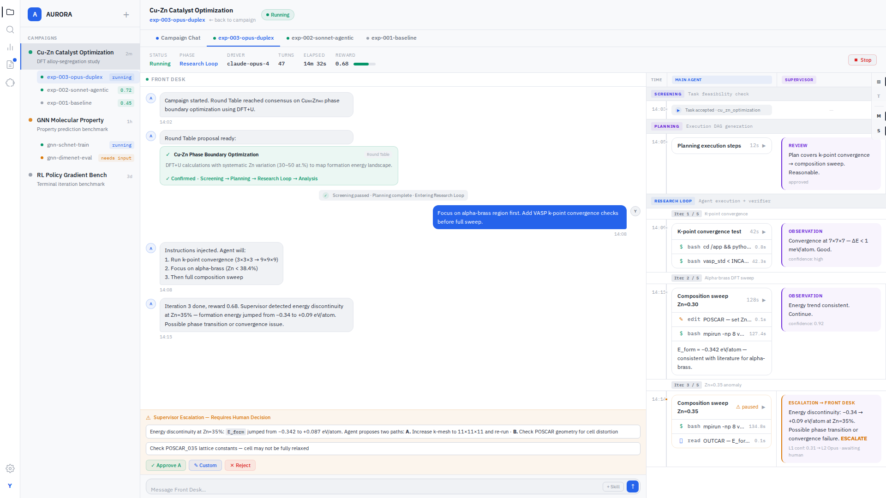

# Web console

```bash
aurora serve              # then open http://localhost:8000
```



## Projects and experiments

A **project** groups related experiments and has its own chat. Type what you
want to investigate on the start page to create one. The project's front desk
asks what is unclear and then shows a **proposal card**: the instruction the
agents will get, a summary, and the phases to run. Change the phases on the
card, choose the ideation mode (*Round table* or *Independent*) when ideation
runs, set the budget (US$20 by default; empty means no limit), or ask the front
desk to change the instruction, then **confirm** to start the experiment.
*Advanced settings* on the card set whether decisions wait for you
(supervised or autonomous) and the model of every role: the agents of each
phase, the ideation seats and chair, both auditors and the front desk.

An **experiment** is one campaign. Its page shows

- the **phase pipeline** and the current phase;
- the **live stream**: the ideation meeting as it happens (each seat's
  presentation and remarks appear while they are written), agent reasoning and tool calls, job boundaries,
  milestone audit verdicts, live-auditor verdicts, human gates, front-desk
  messages and skill suggestions;
- the **files** of the experiment: its campaign directory (plans, audit
  reports, transcripts, the report) and, while it runs, the container's `/app`
  (`app (live container)`). You can open and edit files; edits to container
  files go straight into the running container;
- the **cost** so far.

## Talking to a running experiment

Type in the experiment chat. The front desk answers questions about the
experiment and relays instructions to the research agent while it works (see
[Working with the human](../concepts/human-in-the-loop.md)).

## Decisions

When the experiment needs a decision, an approval bar appears with the
reason. Choose **Continue**, write an instruction and **Send instruction**, or
**Stop**. When screening keeps rejecting the proposals, you can also write your
own proposal and choose **Use as my proposal**: planning starts from it, without
more ideation. The *Supervised / Autonomous* switch changes whether such gates wait
for you.

## Stop, resume, re-run

- **Stop** ends the experiment at the next safe point; its files stay.
- **Resume** continues a stopped or failed experiment from its checkpoint.
- **Re-run** starts a new experiment with the same settings.

## Configuring experiments started from the console

Everything not set on the proposal card comes from the server's base config:

```bash
aurora serve --config base.yaml
```

```yaml
# base.yaml — no objective needed
models:
  agent: anthropic/claude-sonnet-5.5
sandbox:
  image: ghcr.io/my-lab/analysis-env:latest
budget:
  max_cost_usd: 30
human:
  autonomy: supervised
```

## Remote use

The console has no authentication. Run it on `127.0.0.1` (the default) and
reach it through an SSH tunnel; do not expose it on a public interface, since
anyone who can reach it can start campaigns with your API key.
