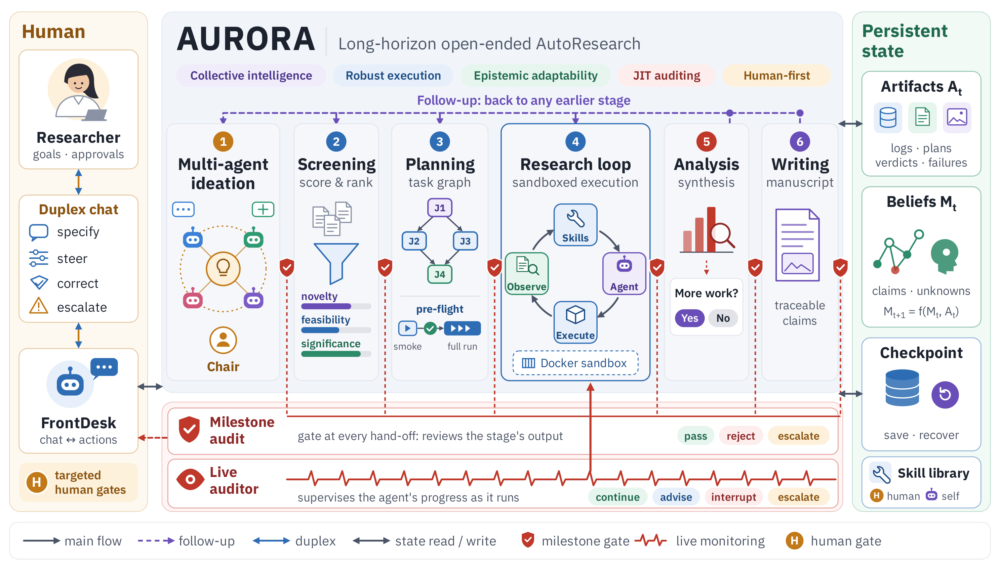

# AURORA

**AURORA runs long, open-ended research campaigns with AI agents — and keeps a human in charge.**

You give it a research question. A group of models proposes directions and a
chair picks one; the chosen direction is screened, planned, and carried out by
a research agent in a sandbox; the results are analysed (with follow-up rounds
when more work is needed) and written up. Two auditors check the work as it
goes, and the campaign asks you whenever a decision should be yours.

## Why

Long research campaigns fail in ways short agent tasks do not. An early mistake
silently corrupts everything built on it; an agent drifts away from the
question; results get overstated. AURORA is built around that:

| Problem | What AURORA does |
|---|---|
| A single model converges on the obvious idea | **Multi-agent ideation**: heterogeneous models propose directions, discuss them (or not) and an independent chair decides. |
| Errors propagate across stages | **Milestone auditor**: every hand-off between phases is reviewed; a phase that fails its audit revises its output. |
| Errors happen *during* long runs | **Live auditor**: a second agent watches the research agent's transcript and advises, interrupts, or escalates. |
| Humans are either absent or a bottleneck | **Human gates** only where a decision is needed, and **duplex interaction**: talk to a running campaign through the front desk agent without stopping it. |
| Know-how is lost between campaigns | **Skill library**: rules you write and rules distilled from past campaigns are available to every agent. |

## Where to start

- **Try it in one minute, offline:** `pip install aurora-research && aurora demo` —
  see [Installation](getting-started/installation.md).
- **Run a real campaign:** [Your first campaign](getting-started/first-campaign.md).
- **Understand the system:** [How a campaign runs](concepts/pipeline.md).
- **Use the web console:** [Web console](guide/web-console.md).
- **Reproduce the paper:** [Reproducing the paper](reproducing.md).

## Citing

If you use AURORA, please cite the paper (see `CITATION.cff` in the repository).
